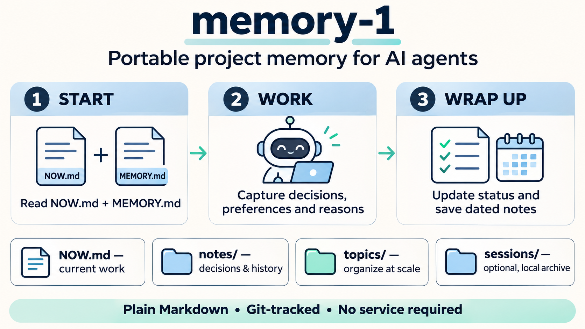

<p align="center"></p>

# memory-1

<p align="center">
  <a href="https://github.com/illescasDaniel/memory-1-skill/actions/workflows/ci.yml"></a>
  <a href="LICENSE"></a>
  
  
  <a href="https://agentskills.io"></a>
</p>

Portable project memory for AI coding agents, stored as Markdown in your repository. Keep current status, decisions, preferences and their history in a form both people and agents can read. Optional session digests preserve additional detail.

- **Shared and reviewable:** files travel with the repository; no service required.
- **History with context:** new notes supersede old decisions instead of erasing them.
- **Clear trust rules:** code wins for current behavior; notes preserve the reasons and history.

## How it works



At session start the agent reads the status and index. As work progresses it records decisions and preferences, then updates the status before finishing.

| In `memory/` | Purpose |
| --- | --- |
| 📍 `NOW.md` | Current work, recent progress and next steps |
| 🗂️ `MEMORY.md` | Index of current notes and history |
| 📝 `notes/` | One dated fact or decision per file |
| 🧭 `topics/` | Optional topic pages for larger memories |
| 📌 `LATER.md` | Open items and follow-up suggestions |
| 🗄️ `sessions/` | Optional, local-only session digests; git-ignored |

<details>
<summary>See an example memory note</summary>

```markdown
---
name: secret-scan-per-line-requests
description: Secret scanner sends one candidate line per model request because batching hurt detection
type: decision
date: 2026-10-05
status: current
supersedes:
superseded_by:
source: 2026-10-05-1a2b3c4d.md
---

The secret scanner sends each candidate line to the local model in its own request.

**Why:** batching several lines dropped detection from 0.87 to 0.37; the extra cost is ~70 ms/line.
**Rejected:** batches of 8 lines.
**How to apply:** do not batch candidate lines when changing the scanner.
```

</details>

## Quick start

```bash
npx skills add illescasDaniel/memory-1-skill
```

Ask your agent **“set up memory-1”**. Add “with the session archive” if you want to export past sessions. Existing project memory is identified and a migration proposed; the old files stay until you confirm removal.

<details>
<summary>Manual installation and agent instructions</summary>

Copy the `skills/memory-1` folder into your agent's skills directory.

| | Project (shared with your team) | All your projects |
|---|---|---|
| Claude Code | `.claude/skills/memory-1/` | `~/.claude/skills/memory-1/` |
| Codex | `.agents/skills/memory-1/` | `~/.agents/skills/memory-1/` |
| Cursor | `.cursor/skills/memory-1/` | `~/.cursor/skills/memory-1/` |
| Others | add the `AGENTS.md` paragraph below | |

For agents that do not load skills, or to make the session-start read guaranteed, add this to `AGENTS.md` (or
`CLAUDE.md`):

```markdown
## Memory

Project memory lives in `memory/`. At session start read `memory/NOW.md` (check it against git) and `memory/MEMORY.md`. Code at HEAD wins for current behaviour;
notes win for why, history and preferences; a `superseded` note is history, not the current answer. For detail, open
the note's `source` session in `memory/sessions/` or grep there. Save decisions (with why), reversals (new note that
supersedes the old), preferences and incidents as one-fact notes. Before ending a session in which work happened,
rewrite `memory/NOW.md` (doing, done, next with the user's next step first). Full protocol: the `memory-1` skill.
```

Export sessions by hand (Python 3.9+, standard library only):

```bash
python3 path/to/skills/memory-1/scripts/export_sessions.py --project .
```

In a git worktree it collects the sessions of every worktree of the repository into the main checkout's
`memory/sessions` and links the worktree's `memory/sessions` to it when it can.

Check the memory folder (sizes, notes missing from the index, broken supersession links); the skill runs it at the end
of a session:

```bash
python3 path/to/skills/memory-1/scripts/memory_check.py --memory memory
```

> [!NOTE]
> Recommended with Claude Code: turn off its built-in auto memory for the project, so there is one memory and it is the
> one in the repository that every agent and teammate can read. Add `"autoMemoryEnabled": false` to
> `.claude/settings.json`. It is a recommendation, not a requirement: the two can coexist, but facts then end up in two
> places and only one of them is shared.

</details>

## Requirements and limits

Python 3.9+, standard library only. Transcript export is opt-in. It reads the local transcript stores of Claude Code,
Codex and opencode read-only, keeps only sessions from this project or its git worktrees, and writes to the git-ignored
`memory/sessions/`. Redaction is pattern-based: skim an export before sharing it. A missing source or a locked opencode
database is skipped with a note.

## Evaluation

The keyless [NVIDIA SkillEvaluator](https://github.com/NVIDIA/SkillEvaluator) quality check gave **A, 93.5/100** on the revision checked on 2026-11-17. SkillSpector reported **medium risk / caution**; its findings and review are in the evaluation details. Some checks apply to the preceding revision, and the paid Tier 3 live-agent evaluation was not run.

In a separate project benchmark, memory-1 scored **1.59/2**, close to searching raw session transcripts (**1.58/2**). This was one project and 30 questions, with the skill shaped on that project; it is not a general ranking. [Evaluation details](docs/evaluation.md) · [Benchmark method and results](docs/benchmark.md)

## Tests

```bash
python3 -m unittest discover -s tests -v
```

The free, standard-library tests exercise the scripts using temporary fixtures. They require no API key and live outside the installable skill folder. They do not measure whether an agent follows the skill. See the [CI workflow](.github/workflows/ci.yml) for the test matrix.

## License

[MIT](LICENSE) · Issues and pull requests are welcome.
